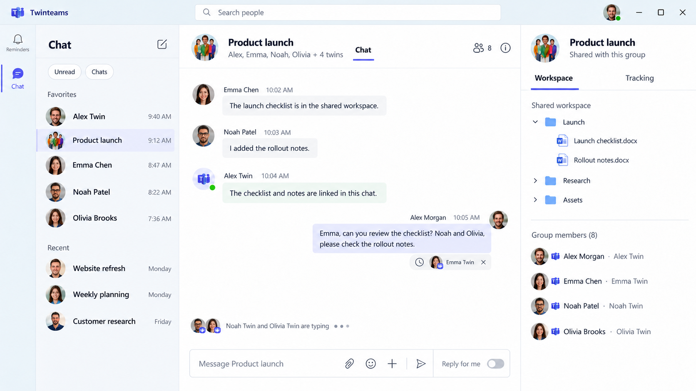
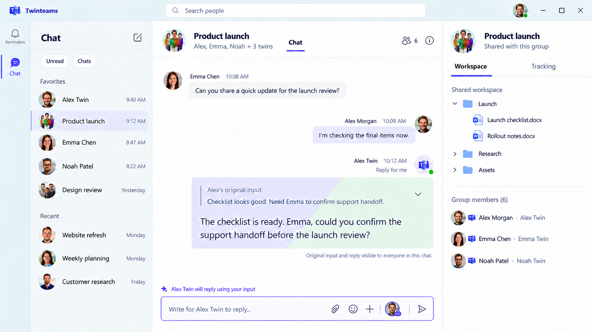
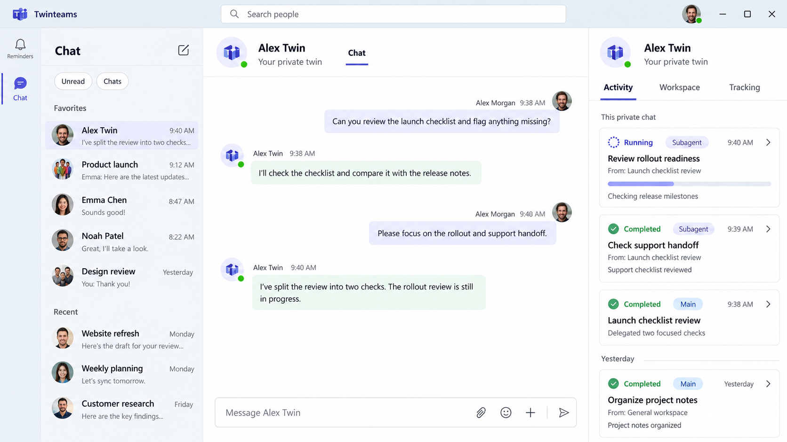

# Twinteams 完整设计评审稿

> Historical audit/design evidence, retained with its original date. Current accepted execution, notification and transport behavior is in [architecture.md](architecture.md). Earlier recommendations are not an implementation contract.

2026-10-17 · 当前产品与交互设计 · 含最新确认的界面图示

本稿集中呈现已经确认的设计，并将尚待细化的交互、Agent Runtime 集成差距与数据库工作单列。产品规则已确认不代表相关功能已经实现。

## 顶层原则：用户关注时，由用户掌握回复主动权

来源：Sentinel_879925eee5b48191b78e24bf99e7ebae（已确认）。

用户正在关注当前对话时，应由该用户决定是否调用自己的 Twins、何时调用。界面提供快速按钮，让用户随时唤起自己的 Twins 回复指定消息；自动补位不应抢走正在关注聊天的用户的表达机会。此处“所有权”指回复主动权与交互控制，不涉及数据归属或法律权利。

该原则与已有分阶段规则一起适用：关注状态抑制新的自动触发；已经接受并进入排队或运行的请求，不因用户开始查看而自动停止，仍需用户主动取消或 Stop replying。此前请求对方 Twins 的手动入口及其权限规则继续有效，本次未新增禁止他人手动请求的限制。

## 1. 产品定位与项目边界

Twinteams 的核心是：每个人都有一个独立身份的数字分身 Twins。真人优先表达；在约定条件下，Twins 代为回应、处理任务，并通过授权机制限制有副作用的行动。

- 存储更新（2026-10-18）：本地开发与部署统一使用 PostgreSQL。业务数据、权限和 FIFO 由 Twinteams 管理；执行日志、恢复、checkpoint 和租约由 Agent Runtime 管理。该选择不改变已确认的交互、来源权限、完整结果保存与项目职责。

## 2. Teams 风格与整体布局

整体布局、间距、字体、配色和标准聊天交互以已选 Teams 参考界面为基准。Teams 没有的 Twins 专属交互，保持同一视觉风格。

左侧主导航只保留“提醒”和“对话”两个入口及对应页面。顶部完整保留搜索框外观，但搜索能力限定为找人，不提供聊天记录聚合搜索。前端阶段可使用占位数据，预留后端人员查询接口。

聊天区域保留聊天列表、标题区、消息区、输入框及右侧栏。标题右上角通过成员人数入口添加成员。标准文件预览等 Teams 已有行为，实施时核对实际参考版本并复刻；不提前把未经核实的打开方式当成定案。

用户明确取舍优先：不能因“复刻 Teams”重新加入被删去的导航、搜索类别或无关功能。

## 3. 身份与两种聊天模式

### 3.1 Owner 与 Twins

每位真人 Owner 对应唯一 Twins，二者是独立身份，关系为 1:1。消息必须能够区分真人发送、Twins 自主发送，以及 Twins 根据 Owner 原始输入代为发送。

### 3.2 私人对话

Owner 与自己的 Twins 的对话，是独立的私人聊天。该聊天有私人工作空间、私人 Tracking、当前私人对话的 Activity，以及属于该聊天的审批抽屉。

### 3.3 Group chat

只要涉及其他真人，都是 Group chat：

- 两位真人：A、B，加 A Twins、B Twins，共四个身份。
- 三位及以上真人：每位真人与自己的 Twins 成对参与。

搜索到其他人并发起对话时，形成两位真人的 Group chat。通过当前聊天右上角成员入口添加其他人的名字，同时加入该真人及其 Twins。

群聊拥有本群共享工作空间与 Tracking。群 Tracking 仅在当前群使用，不能自动混入别群或私人聊天。

## 4. 谁会被自动触发，以及 Twins 之间如何对话

来源：Sentinel_fca0adb1ac888191835278e37f931b47（主动消息及 A Twins 等同 A 的触发语义要求）、Sentinel_5297a0cb1f3c8191b3e0795320e73836（同意完整方案并更新设计）。以下均为已确认设计，不代表已实现。

### 4.1 来源身份与主动消息

Twins 可以在已经获准参与和发送的聊天中主动发消息。A Twins 发给 B 的消息，在 B Twins 的目标路由与触发判断中，按来源 Owner A 的消息处理；多人群同理。群聊中来源方自己的 A Twins 排除出该消息的自动目标，防止自触发。此群路由排除规则不改变 Owner 与自己 Twins 私人对话的直达交互。

这只是业务触发语义，不能把实际作者改成真人 A。消息始终保留 Twin 作者、所属 Owner、主动/回复/替我回复来源、来源 Run 与因果链；UI 继续明确 Twins 署名，不能记成 A 已读或 A 本人授权。

主动发送不允许任意新建聊天、添加成员或扩大受众。跨聊天发送须核对目标聊天及受众的发送授权、成员关系、来源可披露范围；私人聊天、记忆、文件和历史派生内容不能借 Twins 对话泄露。

### 4.2 回复必要性与目标路由

独立路由 LLM 同时判断 needs_response 和候选目标 Owner。感谢、确认、完成通知、没有新信息等消息可以判定 needs_response=false，最终自动目标为空，不需要为了接话而接话。

- 两位真人的群聊仍默认以对方 Owner 为候选，不需要额外的目标推测；独立的回复必要性判断仍然适用。
- 三位及以上真人的群聊由独立 LLM 根据获准群上下文与当前消息推测候选 Owner，与显式 @ 真人合并并去重，再排除来源 Owner。
- 显式 @ 保证进入潜在目标集合，但不强制回复；needs_response=false 时，包括被 @ 的人，最终自动目标也可以为空。
- needs_response=true 时，才对最终目标逐一应用在线、查看与 10 秒规则。不能广播唤起所有 Twins，也不能把来源 Owner 的 Twins 加回来。

例如 A Twins 向 B 提出新问题，B 离线时可接受 B Twins 自动回复；B Twins 只回复“谢谢，已完成”，路由可判无需回应并结束。即使该完成消息 @A，也不自动产生必须回复的义务。路由失败、低置信度的具体反馈及 @Twins 的解析方式仍需细化。

### 4.3 每个目标的触发条件

- Owner 离线：满足回复必要性、权限、去重与因果链预算后，立即接受其 Twins 自动回复。
- Owner 在线，但没有查看当前对话：留出 10 秒真人处理时间；只有到期仍未回复、且未打开查看当前对话时才可接受自动回复。等待期间 Owner 已回复（包括从其他客户端回复），或打开当前对话但没有回复，都不自动触发。
- Owner 正在查看当前对话：不自动触发 Twins。
- Owner 已经读过旧消息，随后离开或离线：不为旧消息补发自动触发。旧消息仍可以手动要求 Twins 回复；独立新真人消息重新应用上述规则并建立新因果链。

在线、当前正在查看、某条消息已读是不同事实。产品需要记录这些状态；心跳、多端、焦点与可见区域的精确技术判定仍需细化。

### 4.4 触发前与触发后必须区分

10 秒等待属于触发资格判断。已经接受触发、进入排队或开始回复后，不因 Owner 打开聊天、已读或开始输入而自动停止。Owner 需要主动取消或打断。下述因果链上限同样只阻止新的自动接受，不能回头停止已经接受的排队/运行项。

### 4.5 全链路自动对话上限与重复防护

每条因果链初始默认允许接受 6 次自动 Twins 回复，可配置；真人 Continue 可追加新段额度。计数跨该链上的所有 Twins、聊天与 SDK Run，共享一个持久预算；不是每个 Twins、每个聊天各有 6 次，也不是运行结束就重新计算。首次自动回复即占一次；多目标各自接受各占一次。

每次新自动请求在真正接受、进入 FIFO 前，原子检查并预留一个名额，和请求去重及接受记录一起提交。并发目标不能各读到同一剩余额度而超支。重复投递或同一重试操作只计一次；已接受请求的内部重试、恢复与重连不重复计费。新的自动 Retry 请求仍沿用该链并占一次新接受名额。

SDK 重启、Run 切换、subagent 结果、跨聊天转发或同一 Run 多次主动发消息都不新建预算。已接受后取消、失败或结束也不抹去该次已接受计数。保留来源消息、父请求、原始根来源与累计已用量；独立的新真人消息才建立新链，显式 Continue 或针对原请求的 Retry 继续原链。

另设确定性的精确重复内容防护：在同链中，不同自动 Twin 消息的规范化正文与同链已处理内容完全相同时，阻止由重复内容产生的新自动接话并记录原因。同一条首次消息的多个目标仍可分别受理，不把同一 message_id 的重投或多目标判成新重复内容。规范化与比较使用固定版本、可重现规则，不做模糊/语义相似度的额外静默丢弃；语义上是否值得回应只由上述 needs_response 判断。该防护不撤回已经发布消息或停止已接受请求。

### 4.6 达到上限后的 UI 与人工继续

用完当前自动额度时，仅暂停该链尚未接受的新自动回复机会，界面明确显示自动对话已暂停及原因，并提供 Continue。已接受的排队项继续按 FIFO，运行项继续执行；不能把预算耗尽映射成 Stop replying、失败或自动取消。

用户明确点击 Continue 后，在同一因果链记录新的真人授权并授予新一段默认 6 次的自动额度（随配置），保留原始 lineage 与历史累计已用量，不把旧链清零。重复点击/重放同一授权不能重复授予额度。继续后仍逐项检查 needs_response、目标 Owner 的在线/查看状态、权限与精确去重。

Ask my Twin / Ask their Twin 与人工 Retry 等真实手动请求仍可使用，遵循原有 FIFO、去重和权限；它们不隐含补充自动额度。工具、Twins 或后台任务不能仅把请求标成 manual 来绕过上限。暂停提示与 Continue 只能呈现用户有权看到的内容，不泄露链中其他私人聊天或工作。此处仅决定产品业务预算与授权；SDK 的 loop、运行持久化、恢复和执行互斥仍由 Agent Runtime 负责。

## 5. 手动触发与已读回执

每条消息提供两个动作：要求自己的 Twins 回复，以及要求目标方的 Twins 回复。

- 两位真人群聊默认选择对方 Twins。
- 三位及以上真人群聊弹出目标列表供选择。是否支持一次多选尚未定案。
- 在线、当前查看或已读，都不取消手动请求入口；去重、排队和权限约束仍然生效。
- 手动要求他人的 Twins 回复，不等于批准它执行有副作用的操作。

消息提供真人 Owner 的已读回执。Twins 读过、处理过或回复过消息，不能算 Owner 已读。回执表达“已经看过”，不推断“故意不回复”。

## 6. 主回复串行、队列与中断

### 6.1 同一聊天、同一 Twins，一次一个主回复

互斥范围为同一 chat 中的同一 Twins，不是该 Twins 跨所有聊天的全局锁。不同聊天可独立处理。

手动和自动只是触发来源。同一逻辑回复成功触发后，另一竞争触发必须禁用、终止或去重，不能产生两份并行回复。主回复忙碌期间的新不同请求进入 FIFO 队列，按接受时间执行，手动与自动同优先级。

### 6.2 Subagent 不持续占用主回复位置

Twins 可以委派 subagent 后回复“已收到，交给子任务处理”，并结束本次主响应。主响应真正结束后即可处理下一请求，即使 subagent 仍在工作。只发出一句确认而本轮运行尚未结束，不等于释放位置。

Subagent 完成后通知主 Twins，主 Twins 总结并发送到对应聊天。父子 Agent 通信归 Agent Runtime，Twinteams 不另建一套通信机制。

### 6.3 状态栏和取消位置

假设 A 的一条消息请求 B、C 的 Twins，而二者正忙：

- A 的消息下方以紧凑子项并行显示 B、C 的排队状态：排队图标、头像、Twins 标识及有权限时的关闭图标；正在回复移至输入框上方 typing 区域。
- A 能在自己消息下取消相应排队项。
- 其他人看到相同状态，但不看到该位置的取消按钮；B、C 本人也一样。
- B 在自己的输入框区域看到 B Twins 的排队提示并可取消；C 同理。
- 每个取消动作只影响对应目标请求，不连带取消其他 Twins。

已确认的权限原则是：请求者可以取消自己发起的排队请求；Owner 可以取消发给自己 Twins 的排队请求。手动请求者不是原消息作者时，其取消入口具体放在哪里，仍需补充。

### 6.4 回复进行中与手动中断

Owner 的输入框处展示 “Your twin is typing…” banner，并提供 “Stop replying”。Owner 回到聊天时只展示状态，不自动中止。

主动中断后，撤销这一次被中断响应已经输出的内容，然后开始下一排队请求。不会因此删除更早完成的回复。已经执行的工具副作用是否回滚、subagent 是否停止，属于后续 Runtime 规则，不能从撤销文字自动推导。

### 6.5 完成、失败与重试

- 原消息下仅显示图标化排队子项；正在回复用输入框上方 Teams typing 动态展示，多个头像叠放并显示名字。Failed / Retry 保留为异常提示。
- Twins 完成回复时引用它所回应的原消息，以该回复表示完成；移除该 Twins 对应活动状态。
- 其他仍在工作的 Twins 继续显示；全部结束且没有失败项时，整条状态栏消失。不增加 Completed 汇总或终态折叠栏。
- 失败是例外：保留 Failed 提示与 Retry。
- 重试作为新接受的请求进入同一 FIFO 队列，不插队，也不影响其他 Twins。

主回复完成和后台任务完成是两件事。

### 排队子项与 Teams typing 展示（最新确认）

来源：Sentinel_1986f51eaa088191bc054be083e5450b。此决定替代此前在原消息下显示 Replying 的布局，执行状态及 FIFO 规则不变。

- 原消息下仅使用紧凑、从属于消息的排队子项：排队图标、对应头像及 Twins 标识、具备取消权限时的关闭图标。缩小尺寸，尽量以图标表达，避免大段状态文字。
- 正在回复不再显示于原消息下。改用输入框上方 Teams 风格 typing 动态：头像、姓名/typing 信息及动态效果；多人时头像叠放并列出正在输入的名字。
- 原消息下取消图标仍仅向具备该位置权限的发送者展示；其他人仅见排队状态。Twins Owner 在自己的输入框区域管理自己 Twins 的排队请求，不能因此在他人原消息下获得取消按钮。
- Owner 主动 Stop replying 的能力保留，进入聊天不会自动停止；需与 typing 区域协调呈现，不因简化原消息子项而移除中断入口。
- 失败提示和 Retry 是之前已确认的例外，最新要求未撤销它们；成功完成移除对应活动提示，没有 Completed 汇总栏。

### 图 2 · 群聊排队子项与 typing

对应正文第 6 节。原消息下只保留紧凑排队子项：排队图标、头像、Twins 标识和授权可见的关闭图标。正在回复放到输入框上方，头像叠放并展示姓名及 typing 动态。Failed / Retry 仍是异常提示例外。

取消权限沿用正文：发送者在自己的消息下操作，Twins Owner 在自己的输入框区操作。图中旧 “Reply for me” 文字开关已被图 3 的独立 Twins 图标取代；人数口径不因图中数字定案。

## 7. “替我回复”模式

输入框内提供独立开关。开启后输入框周围变色，明确提示当前模式，用户可随时手动关闭。

- 开关按 Owner、按群聊独立保存；A 群开启不影响 B 群。
- 提示词采用全局默认，并允许单个聊天覆盖。提示词继承与模式开关是两种设置。
- Owner 的输入先交给自己的 Twins，Twins 根据提示词处理或丰富后，直接以 Twins 身份发送，不插入草稿确认步骤。
- 已发送气泡内能够查看 Owner 原始输入与 Twins 最终文本。所有有权读取该消息的人都能看到二者，不仅 Owner。
- 原始输入和最终输出需分别保存并关联，继承同一消息访问范围。

消息气泡分三类：真人 Owner 为一种单色；Twins 自主回复为另一种单色；“替我回复”是一个 Twins 回复气泡，淡紫/薄荷绿底色以斜线硬分界，不使用渐变。上方是弱化、可折叠的 Owner 原始输入引用，下方是加工回复，不使用左右内容分栏。精确色值、分割比例及默认折叠状态尚未指定。

### 替我回复气泡：上下内容与斜线双色（最新确认）

来源：Sentinel_fc8f60bde2bc8191ab3d206070f3c568，针对第三张设计图。

- 继续使用图中淡紫/薄荷绿两种底色方向，用户已认可背景色；未指定精确色值。
- 整体为一个以 Twins 署名的回复气泡；上方为 Owner 原始输入的弱化引用块，可折叠，下方为 Twins 加工后的回复。不能排成左右两列，也不把原始输入另发为左侧真人消息。
- 同一气泡的两种底色通过清晰斜线硬分界；替代此前垂直分割的视觉理解，不使用渐变。
- 可折叠能力已确认，默认展开还是折叠尚未指定。保持英文 UI。
- 原始输入及加工结果仍向所有有权阅读该消息的人可见，继承消息历史权限；折叠只影响呈现，不改变访问范围。

### Reply for me 入口图标化（最新确认）

来源：Sentinel_77e8b4b77ce48191a06d4aecece0058e，针对第三张设计图。

- 输入框内的 Reply for me 入口采用紧凑、独立图标，移除厚重的常驻文字按钮。
- 图标需体现 Twinteams 特点，可使用对应 Twins 的头像；点击激活，仍沿用可手动关闭及每位 Owner/群组独立开关的既有规则。
- 模式开启后输入框边框变色的确认规则继续生效。
- 图标高亮和悬浮提示名称是后续呈现建议，尚未单独确认；不新增常驻文字标签，不借此变更设置或其他功能。

### 图 3 · 替我回复与独立 Twins 图标

对应正文第 7 节。一个 Twins 署名气泡，上方是弱化、可折叠的 Owner 原始输入引用，下方是加工回复；淡紫与薄荷绿采用清晰斜线硬分界，不做渐变或左右内容分栏。

输入框用紧凑独立 Twins 头像图标控制模式，开启时边框变色；每位 Owner、每个群独立保存。原始输入和加工结果对所有获准读消息的人可见。图标高亮、提示文案及默认折叠状态仍未单独定案。

## 8. 授权、审批抽屉与提醒

### 8.1 权限基本原则

Twins 在 Owner 不知情时默认只处理只读权限内的要求。涉及副作用的动作需要 Owner 授权；若 Owner 已明确设定某类任务可默认执行，则可以在该授权范围内直接执行。

自动触发、手动触发、目标自动加入 Tracking，都不等于授予额外执行权限。

### 8.2 按聊天、按审批人独立的抽屉

私人聊天与每个群聊都在输入框区域提供审批抽屉。只向当前用户展示需要本人处理的审批，可展开和收起。

- 待审批项用 tab 累计，按到达顺序追加。
- 已有三项时，新项成为第四项；不是只保留三项，也不覆盖旧项。
- 默认停在第一项等待处理；用户手动切换后保持当前项。新审批不抢焦点，不自动跳到最新项。
- 处理完当前项，自动切到下一待审批项。
- 全部处理完毕，抽屉自动收起。

审批卡片提供 Approve、Reject、View details；批准或拒绝仅针对本次具体请求。详情说明具体动作、目标及影响；长期默认授权的管理入口留到 Runtime 阶段。

### 8.3 审批不阻塞后续对话

A 要求 B Twins 执行需要授权的操作时，由 B Twins 向 B Owner 发起审批。审批独立等待，Twins 可以结束本轮回复并继续受理后续消息；通过工具查询审批状态决定是否执行该受控动作。不能把待审批当成全局运行锁，也不能在未批准时先执行受控动作。

授权请求及需要 Owner 注意的通知采用 Teams 风格的提醒 UI。通知跳转、已读、审批历史、过期与恢复细节仍需补充。

## 9. 原始历史、摘要与新成员权限

### 9.1 所有聊天完整落盘

所有原始聊天记录完整保存，并保留消息、发送身份、回复引用、触发请求及运行的关联。定期生成摘要，摘要不能替代原始记录。

每次回复使用最新适用摘要，加上摘要覆盖边界之后的原始消息。更早内容通过专用工具精确查询。私人聊天同样遵循摘要与近期原文衔接，并加入 Tracking 索引及 Runtime memory。

摘要周期、近期条数和窗口参数尚未指定；不能因为只截取“最近几条”而漏掉摘要之后的中间记录。

### 9.2 新成员的三种历史范围

添加成员时支持：全部历史、入群时刻向前固定 7 天的历史、不开放入群前历史。7 天是入群时固定边界，不是滚动窗口。真人及其 Twins 使用同一历史访问范围。

该规则替代之前“新成员默认看全部历史”的早期要求。

### 9.3 摘要按权限取用，并尽量复用

同一群中，拥有相同可见来源范围的成员与 Twins 可以复用摘要。新成员范围不同，则获取或生成适用于其范围的摘要。

“7 天前生成的摘要”不一定安全：如果它累计包含更早消息，不能喂给新成员的 Twins 再要求模型忽略越权部分。只能复用底层来源全部获准的摘要片段；否则从授权原始记录重建。

历史查询工具、摘要、Tracking 标题与动态等派生内容，均不能绕过原始权限边界。群共享并不意味着每个人拥有全部历史。私人记忆或私人文件在群内如何使用，留待 Runtime 与记忆管理讨论。

## 10. Tracking：主题索引与动态链条

Tracking 从聊天中自动提取主题、目标并加入列表，无需先确认草稿。每个 Tracking 有主题、简短描述，以及按时间关联的动态链条。

主题和简短描述作为目录，始终对当前相关 Twins 可见。Twins 发现当前对话可能相关时，通过工具查找该主题的动态与细节，主动补齐上下文；不会始终把所有详情塞入上下文。

两类范围：

- 私人 Tracking：属于 Owner 与自己 Twins 的私人对话，由 Owner 及其 Twins 管理。
- 群 Tracking：每个群可以自动创建，群内 Twins 共享，仅当前群使用。群内所有真人和对应 Twins 均可修改、删除。

Owner 可以在列表管理目标，主要是删除，也可以直接用自然语言要求 Twins 修改。已删除目标不从旧记录自动复活，直到 Owner 重新提出。目标自动入列不等于自动授权执行相关任务。

群 Tracking 的目录与动态仍遵守成员历史范围。具体字段、状态集合、并发修改和历史追踪机制留待数据设计。

## 11. 右侧栏与工作空间

私人聊天的侧栏展示 Twins 头像与名字，并提供 Activity / Workspace / Tracking。群聊侧栏提供 Workspace / Tracking，工作空间为本群共享空间。

初次默认展开；私人聊天默认 Activity，群聊默认 Workspace。以后按用户、按聊天恢复最后使用的页签及展开/收起状态。

Workspace 展示对应目录结构。标准文件打开和预览方式遵循实际 Teams 参考行为；当前不另行确定未经验证的替代流程。

## 12. Activity：当前私人聊天的 Run 卡片

### 12.1 展示范围

只展示当前 Owner 与自己 Twins 的私人聊天产生的运行，以及由这段私人对话发起的 subagent 运行。不汇总其他群聊，也不做 Twins 全局运行列表。

### 12.2 Chat、Session、Run、Event

Chat 是产品聊天容器。Agent 的执行会话需要关联到对应聊天与 Twins；同一个 Twins 在不同群聊中的执行上下文不能混成一个会话。

一次输入触发 Agent reaction、进入 loop、形成完整总结并结束，是产品视角的一次 Run。输入可能来自真人或其他 Twins，但这一定义不额外批准所有 Twins 消息自动唤起其他 Twins，触发仍服从前述规则。

一次 Run 产生多个 Event。主 Twins 的响应和 subagent 的运行分别以独立卡片展示，并保留来源与父子关联。

这里需要持久保存的是语义事件及完整结果，临时 token 不要求逐条记录。每个已完成模型/工具操作的完整 output 都应保留，不能只留下整个 Run 最后的一条总结。

### 12.3 卡片与详情

- 按时间倒序展示，最新在顶部。
- 卡片图标区分正在进行与已经完成。
- 点击卡片，以抽屉打开详情，用链条顺序呈现 Event，查看获准展示的输入、输出及工作进度。
- subagent 卡片能关联原始请求、工作过程和结束总结。
- 失败、停止不得错误显示为成功完成；具体图标和排序采用开始时间还是完成时间仍待细化。
- 这里的“思考/工作内容”是面向用户的进度、结构化事件与允许查看的输入输出，不展示隐藏内部推理、密钥或越权数据。

### 12.4 临时 token 与完整 output 恢复（已确认）

来源：Sentinel_163f756d0bc0819183270b91e8d32935。用户说明当前使用 response API，逐字 token 最终由对应 detail 级别事件的完整 output 汇总。

- 正常连接时，token delta 可尽力提供打字机效果；它们是临时展示数据，允许丢弃。
- 恢复、重连及未来集群跨 pod 接管时，通过 SDK 从数据库读取已提交的完整 output 直接展示，不补 token、不回放旧动画，也不依赖旧 pod 的流缓冲。
- 保存和恢复的单位是每个已完成的模型调用、工具调用或其他产出结果的语义操作/事件；不是等到整个 Run 结束才保存最终回复。
- 当前操作尚无已提交完整 output 时，只展示已知 Run 状态，保留其他已完成操作的结果；不虚构缺失文字或声称逐 token 无缝续写。完整结果到达后覆盖对应临时文本，不重复拼接。
- token 丢失不影响 SDK 对 Run、语义事件、模型/工具完整结果及 checkpoint 的持久性要求。Twinteams 只消费 live 流和完整结果，不新增 token/chunk 持久表或 token 恢复游标。

### 图 1 · 私人对话与 Activity

对应正文第 3、11、12 节。右侧 Activity 以 Run 为独立卡片，主 Twins 与 subagent 分别展示，按时间倒序；点击打开 Event 链条详情。只包含当前私人对话及其衍生子任务。

图中 “From: General workspace” 是示意占位文案，不表示允许聚合其他工作空间或群聊的运行；实现必须遵循当前私人对话范围。

## 13. Agent Runtime：现有基础与集成缺口

以下是项目已有只读核对记录中的 SDK 状态，与产品确认分开列示。

本节用于明确产品依赖的 SDK 接口与已核对差距，不是 Twinteams 实现 Agent loop、持久队列、租约、checkpoint 或恢复的任务清单。运行机制由 Agent Runtime 项目处理，Twinteams 负责业务调用、来源映射与呈现。

已有基础：SDK 具备 session_id、tenant_id、user_id；有 agent_sessions、runs、events 持久化结构；Run 状态包括 running、completed、stopped、failed；有 subagent 的 spawn、wait、send 及订阅等原语。

需要对齐或补齐：

1. 聊天与 Twins 映射。SDK 当前没有直接的 chat_id / twin_id；需要宿主维护对应关系，具体字段与表结构尚未决定。
2. 主回复边界。resume 会延续原 Run；运行结束后再次 prompt 会创建新 Run。运行中追加输入可能仍在同一 Run，产品的逐请求 FIFO 不能假设 SDK 已自动满足。
3. 子任务完成回传。已有通信原语不等于持久父任务收件箱、自动唤醒、聊天路由和发送消息的端到端闭环。已核对的文档明确说明子任务结果不会自动注入或唤醒模型；需继续完善集成。
4. 可靠排队。现有 enqueue / steer / follow_up 是内存排队原语，不等于持久队列及自动执行；应与产品请求队列分清。
5. 关联模型。task_id、child session 与 run_id 不等价，一个子任务会话可能有多个 Run；root_run_id 也不能总当作直接父 Run。
6. 结束总结。run_completed 不保证带有文本总结，不能仅凭结束事件假设已有卡片所需总结。
7. Activity 数据接口。尚无直接满足列表与单 Run 详情的完整 HTTP feed；现有 daily_runs 过滤不能直接覆盖私人对话及其全部后代运行。
8. Event 展示。实时 token 可丢弃，恢复读取已提交的语义事件与完整 output；工具结果可能需解引用，历史读取还需考虑归档。SDK 提供运行事实，产品对外展示仍需权限检查与敏感信息处理。

核对依据包括 Agent Runtime 的 docs/subagents.md 及此前记录的代码版本 1873697；这不是对后续版本永远不变的断言。

## 14. 数据设计需要覆盖的关系

本节是表设计输入，不是已定稿的表名、字段或数据库 DDL。

- 身份：Owner、Twins、唯一配对关系。
- 聊天：类型、成员与身份配对、成员加入时间及历史可见边界。
- 消息：作者身份、来源 Owner、来源类型、引用、替我回复原始输入与输出、真人已读记录；主动消息的 Run/父来源/因果链与披露来源。
- 回复请求：目标 Twins、触发来源、去重关联、排队顺序、状态、取消者与关联 Run；同一持久因果链、全链自动接受计数、原子预算预留、暂停原因及真人 Continue 授权。
- 运行映射：产品 Chat 到 SDK Session、Run、Event、subagent 任务及父子来源链的引用；语义事件、每次操作完整 output 和 checkpoint 由 SDK 保存，不复制运行日志。
- 审批：来源聊天、请求 Twins、审批 Owner、受控动作、决定与状态。
- 摘要：授权来源范围、覆盖边界、原始来源及可复用关系。
- Tracking：私人或群作用域、主题索引、动态链、相关消息/任务及删除状态。
- UI 与个人设置：每聊天模式开关、提示词覆盖、侧栏状态；在线/查看状态与通知记录。
- 工作空间：个人或群归属、目录/文件关联及访问权限。

存储更新（2026-10-18）：本地开发与部署统一使用 PostgreSQL。业务数据、权限和 FIFO 由 Twinteams 管理；执行日志、恢复、checkpoint 和租约由 Agent Runtime 管理。该选择不改变已确认的交互、来源权限、完整结果保存与项目职责。

## 15. 尚待细化与明确后置的内容

主动 Twin 对话、needs_response 可产生空目标、显式 @ 仅为潜在目标、共享默认 6 次自动接受上限、精确重复防护和 Continue 已确认，详见第 4 节，不再属于本节待定内容。剩余内容集中在以下几组：

- 触发边界：在线与查看的多端/焦点判定、10 秒起算、连续消息是否合并；路由失败、低置信度及 @Twins 解析的具体表现。
- 少数权限与操作位置：请求者不是原消息作者时在哪里取消；目标选择是否多选；成员退出、历史权限变更与已排队请求的关系。
- 展示细节：人数口径、气泡色值/分割比例、原始输入展开方式、Run 时间排序键与失败/停止图标。标准 Teams 文件行为需实际核对。
- 通知与生命周期：提醒详情、审批历史/过期/恢复；摘要周期与编辑撤回后的派生内容处理。
- Runtime 与数据：私人上下文、长期记忆和授权管理后续讨论；数据库最终 schema、API 合约、持久队列、回传唤醒与 Activity 查询尚需实现设计。

这些待定项不改变已确认原则：真人查看时不自动接话；接受触发后只由用户主动停止；同一聊天同一 Twins 主回复串行；审批独立等待；历史与派生内容必须遵守权限；Activity 只展示当前私人对话及其子任务。

## 16. 评审依据

本稿整合项目内 product-requirements.md、interaction-rules.md、requirements-original-2026-10-17.md、requirements-supplement-2026-10-17.md 及截至本轮的最新确认，包含 Sentinel_fca0adb1ac888191835278e37f931b47、Sentinel_5297a0cb1f3c8191b3e0795320e73836 的主动 Twin 对话完整方案。后来的明确决定覆盖早期提案；未确认的建议保留为待定，不作为既定实现要求。
